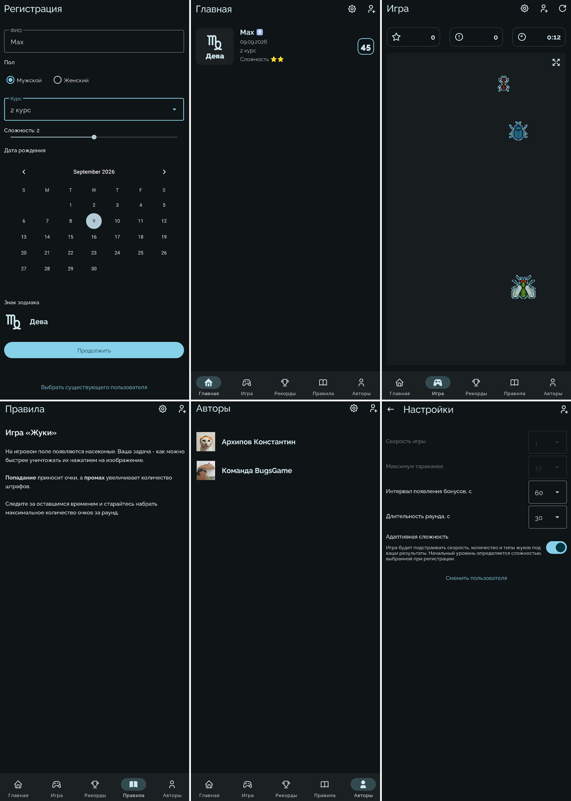

# BugsGame

**BugsGame** – Android-игра на реакцию, в которой нужно ловить движущихся насекомых на игровом поле. Игрок создаёт профиль, настраивает параметры раунда, набирает очки и соревнуется за лучший результат. В игре также предусмотрена адаптивная сложность, которая подстраивает игровой процесс под текущую эффективность игрока.

## Скриншоты

## Функциональность

### Регистрация и профиль игрока

При первом запуске открывается экран регистрации. Для создания профиля необходимо указать:

- ФИО;
- пол;
- курс (1-4);
- дату рождения;
- начальную сложность (1-3);

Знак зодиака определяется автоматически по дате рождения. Поле ФИО обязательно; после удаления пробелов по краям имя должно быть уникальным – повторная регистрация с уже занятым именем отклоняется. На экране также доступен выбор ранее созданного пользователя.

На главном экране отображаются данные активного профиля: ФИО, пол, дата рождения, курс, уровень сложности, знак зодиака и лучший результат.

### Настройки игры

Параметры раунда:

| Параметр            | Диапазон | Значение по умолчанию | Влияние                                                        |
| ------------------- | -------: | --------------------: | -------------------------------------------------------------- |
| Скорость игры       |     1–10 |                     5 | Влияет на скорость перемещения обычных насекомых               |
| Максимум насекомых  |     1–10 |                     3 | Ограничивает количество обычных насекомых на поле одновременно |
| Интервал бонусов    |   5–60 с |                  15 с | Определяет период появления бонуса                             |
| Длительность раунда | 30–300 с |                  60 с | Определяет продолжительность игрового раунда                   |

Настройки сохраняются локально в `SharedPreferences` и восстанавливаются после перезапуска приложения. Они общие для приложения и не привязаны к конкретному профилю.

**Адаптивная сложность** включается отдельным переключателем. В этом режиме скорость и максимальное количество насекомых задаются алгоритмом, поэтому соответствующие элементы настроек становятся недоступны. Интервал бонусов и длительность раунда остаются доступными. Начальный уровень адаптации определяется сложностью, выбранной при регистрации.

### Игровой процесс

Раунд начинается по нажатию кнопки старта. На поле появляются движущиеся насекомые; нажатие на насекомое удаляет его с поля и начисляет очки. Пустое нажатие считается промахом и увеличивает количество штрафов. На экране отображаются текущие очки, штрафы и оставшееся время. Поддерживается полноэкранный режим.

Типы обычных насекомых различаются ценностью и скоростью:

| Насекомое       | Очки за попадание | Множитель скорости |
| --------------- | ----------------: | -----------------: |
| Жук (`BEETLE`)  |                 1 |               0,8× |
| Муравей (`ANT`) |                 2 |               1,0× |
| Муха (`FLY`)    |                 3 |               1,2× |

В обычном режиме тип насекомого выбирается случайно. При адаптивной сложности алгоритм отдельно регулирует долю быстрых насекомых – мух.

#### Бонус

Через заданный в настройках интервал на поле появляется бонус. Нажатие на него активирует бонусный режим на 7 секунд: движение насекомых начинает зависеть от наклона устройства. После завершения режима насекомые получают новые направления движения.

#### Золотой жук

Появляется с интервалом 20 секунд и приносит дополнительное количество очков. Награда рассчитывается на основе цены покупки золота за грамм по данным Банка России: цена делится на 100, округляется до целого и ограничивается диапазоном от 1 до 500 очков. До получения актуальной цены используется значение по умолчанию – 100 очков. Золотой жук быстрее обычного.

Итоговый результат раунда зависит от набранных очков, штрафов, сложности, скорости, ограничения количества насекомых и длительности раунда. Подробная формула приведена в разделе [«Расчёт очков»](#расчёт-очков).

### База данных и таблица лидеров

Локальная база данных Room хранит профили игроков и их лучшие результаты. Имя игрока используется как первичный ключ, поэтому два профиля с одинаковым именем создать нельзя. История отдельных раундов не сохраняется – для каждого профиля хранится только лучший итоговый результат.

Экран **Рекорды** формируется из всех профилей в базе данных. Сначала отображаются игроки с большим `bestScore`; при равенстве очков применяется сортировка по имени без учёта регистра. Позиция в списке является местом игрока в рейтинге, а профиль текущего пользователя визуально выделяется.

### Дополнительные экраны

**Правила** содержат краткое описание основного игрового процесса. **Авторы** показывают информацию об авторах приложения.

### Виджеты Android

Приложение предоставляет два виджета для главного экрана устройства:

| Виджет     | Размер | Содержание                                                        |
| ---------- | -----: | ----------------------------------------------------------------- |
| Компактный |    2×2 | Цена покупки золота за грамм и индикатор изменения цены           |
| Подробный  |    3×3 | Цены покупки и продажи золота за грамм и индикатор изменения цены |

Виджеты получают данные Банка России, используют локальный кеш и поддерживают принудительное обновление по нажатию. Плановый период обновления Android-виджета – 30 минут.

## Реализация и механики

### Архитектура приложения

Приложение построено по подходу **Single Activity**: `MainActivity` содержит навигационный контейнер, а основные экраны реализованы через `Fragment`. Логика экранов вынесена в `ViewModel`; данные и события UI передаются через `StateFlow` и `SharedFlow`.

Код разделён на три основные области:

| Область        | Назначение                                                                               |
| -------------- | ---------------------------------------------------------------------------------------- |
| `presentation` | Экраны, адаптеры, игровое поле, датчик наклона и звуковое сопровождение                  |
| `domain`       | Игровые правила, расчёт итогового счёта, адаптивная сложность, модели предметной области |
| `data`         | Room, репозитории, настройки, данные знаков зодиака и получение котировок золота         |

Зависимости между компонентами связываются через `Koin` в `AppModule`. XML-разметки экранов связываются с Kotlin-кодом через `ViewBinding`.

### Расчёт очков

В расчёте используются:

- $P$ – очки, набранные за раунд, включая награду за золотых жуков;
- $M$ – количество промахов;
- $T$ – длительность раунда в секундах;
- $d$ – выбранная при регистрации сложность;
- $s$ – базовая скорость игры;
- $n$ – базовое максимальное количество насекомых.

Сначала учитываются штрафы:

$$
P=\max(P-1.5M,\ 0)
$$

Затем оценивается ожидаемое количество появлений насекомых при стандартном интервале 900 мс и среднем значении 2 очка за насекомое:

$$
N_{base}=\max\left(\left\lfloor\frac{1000T}{900}\right\rfloor,\ 1\right)
$$

$$
R=\operatorname{clamp}\left(\frac{P}{2N_{base}},\ 0,\ 1.4\right)
$$

Множитель сложности:

$$
F_d=\begin{cases}
0.9, & d=1\\
1.0, & d=2\\
1.1, & d=3
\end{cases}
$$

Множитель скорости и количества насекомых вычисляется линейной интерполяцией в заданных диапазонах:

$$
F_s=0.85+\frac{s-1}{9}(1.15-0.85)
$$

$$
F_n=0.9+\frac{n-1}{9}(1.1-0.9)
$$

Множитель продолжительности раунда:

$$
F_t=\operatorname{clamp}\left(\sqrt{\operatorname{clamp}\left(\frac{T}{60},\ 0.5,\ 2\right)},\ 0.75,\ 1.25\right)
$$

Итоговый результат:

$$
Score=\operatorname{clamp}\left(\operatorname{round}(R\cdot500\cdot F_d\cdot F_s\cdot F_n\cdot F_t),\ 0,\ 1000\right)
$$

Таким образом, штраф уменьшает учитываемые очки на 1,5 за каждый промах, а итоговый результат ограничен диапазоном 0–1000. Коэффициенты сложности, скорости, количества насекомых и длительности корректируют результат относительно базовых условий.

**Связь с адаптивной сложностью.** Адаптация меняет параметры игрового процесса, но не подменяет исходный уровень сложности и базовые параметры, используемые при начислении итоговых очков. Поэтому временное упрощение игры не уменьшает множители результата из-за того, что алгоритм снизил сложность в ходе раунда.

### Адаптивная сложность

Алгоритм начинает с базовых параметров, соответствующих сложности профиля:

| Уровень при регистрации | Базовая скорость | Максимум насекомых | Интервал появления | Доля мух |
| ----------------------- | ---------------: | -----------------: | -----------------: | -------: |
| 1 – лёгкий              |                3 |                  2 |            1400 мс |      15% |
| 2 – обычный             |                5 |                  3 |             900 мс |      33% |
| 3 – сложный             |                7 |                  5 |             500 мс |      50% |

Во время раунда сохраняются события попаданий и промахов. Алгоритм анализирует последние **15 секунд** и пересчитывает сложность каждые **5 секунд**. Для оценки используются только обычные насекомые: число попаданий, число промахов, среднее время реакции и набранные за них очки. Для принятия решения требуется не менее трёх попыток в окне анализа. Нажатия на бонус и золотого жука не входят в метрики адаптации.

Показатели нормализуются:

$$
C=\frac{H}{H+M}
$$

$$
Q_r=\begin{cases}
0, & H=0\\
\operatorname{clamp}\left(\frac{1500-\bar t}{1500-250},\ 0,\ 1\right), & H>0
\end{cases}
$$

$$
Q_p=\operatorname{clamp}\left(\frac{P_w/15}{0.4},\ 0,\ 1\right)
$$

где $H$ – попадания, $M$ – промахи, $\bar t$ – среднее время реакции в миллисекундах, $P_w$ – очки за обычных насекомых за окно анализа.

Общая эффективность рассчитывается как взвешенная сумма:

$$
E=0.5C+0.3Q_r+0.2Q_p
$$

Далее алгоритм принимает решение:

| Эффективность     | Изменение сложности   |
| ----------------- | --------------------- |
| $E < 0.35$        | Уменьшить на один шаг |
| $0.35 ≤ E ≤ 0.70$ | Не менять             |
| $E > 0.70$        | Увеличить на один шаг |

Внутренний уровень адаптации ограничен диапазоном $−2…+2$. На его основе пересчитываются параметры:

$$
s=\operatorname{clamp}(s_0+a,\ 1,\ 10)
$$

$$
n=\operatorname{clamp}(n_0+a,\ 1,\ 10)
$$

$$
I=\operatorname{clamp}\left(\operatorname{round}\left(\frac{I_0}{1+0.10a}\right),\ 350,\ 2000\right)
$$

$$
f=\operatorname{clamp}(f_0+0.08a,\ 0.10,\ 0.70)
$$

Здесь $a$ – текущая ступень адаптации; $s₀$, $n₀$, $I₀$ и $f₀$ – базовые параметры выбранного профиля; $f$ – доля мух. При снижении эффективности игра замедляется, число одновременно активных насекомых и доля быстрых насекомых уменьшаются. При высокой эффективности параметры изменяются в обратную сторону. Адаптация сбрасывается к базовому уровню при запуске нового раунда.

### Определение знака зодиака

Для выбранной даты создаётся значение `MonthDay` – месяц и день без года. Список знаков и границы дат загружаются из [`res/xml/zodiac_signs.xml`](/app/src/main/res/xml/zodiac_signs.xml). `ZodiacCalculator` перебирает диапазоны и возвращает первый знак, для которого дата попадает в интервал включительно.

Для обычных интервалов проверяется условие `start ≤ date ≤ end`. Для интервала, пересекающего границу года (Козерог: 22 декабря – 19 января), используется проверка `date ≥ start || date ≤ end`. Это календарное сопоставление по заданным диапазонам, а не астрономический расчёт.

### Хранение данных

#### Room

База `bugsgame.db` содержит таблицу `users`:

| Поле         | Тип        | Назначение                               |
| ------------ | ---------- | ---------------------------------------- |
| `name`       | `TEXT`, PK | Уникальное имя профиля                   |
| `gender`     | `TEXT`     | Пол                                      |
| `course`     | `TEXT`     | Курс обучения                            |
| `difficulty` | `INTEGER`  | Начальная сложность 1–3                  |
| `birthDate`  | `TEXT`     | Дата рождения в формате ISO `YYYY-MM-DD` |
| `zodiacName` | `TEXT`     | Название знака зодиака                   |
| `bestScore`  | `INTEGER`  | Лучший итоговый результат                |

Добавление пользователя выполняется с политикой `IGNORE` при конфликте первичного ключа. Лучший результат обновляется только тогда, когда новый результат выше сохранённого. Запрос списка профилей сортирует записи по `bestScore DESC`, затем по имени без учёта регистра (`NOCASE`). Таблица лидеров не хранится отдельно – она строится запросом к `users`.

#### Настройки игры

В файле `SharedPreferences` с именем `game_settings_preferences` сохраняются ключи `speed`, `max_cockroaches`, `bonus_interval_seconds`, `round_duration_seconds` и `adaptive_difficulty_enabled`. При чтении и обновлении числовые значения ограничиваются допустимыми диапазонами.

#### Кеш котировок

Отдельный набор `SharedPreferences` `cbr_gold_price_cache` хранит дату котировки, цены покупки и продажи, а также предыдущую цену покупки. При сетевой ошибке используется доступная кешированная запись.

## Используемые технологии

| Технология                                   | Назначение                                                      |
| -------------------------------------------- | --------------------------------------------------------------- |
| Kotlin                                       | Основной язык приложения                                        |
| Android SDK, Java 17                         | Платформа и целевая среда сборки                                |
| Gradle Kotlin DSL                            | Конфигурация сборки в `*.gradle.kts` и `libs.versions.toml`     |
| XML Layouts, Material Components             | Разметка экранов и элементы интерфейса                          |
| Single Activity, AndroidX Fragment           | Организация экранов через `Fragment`                            |
| AndroidX Navigation Component                | Навигация между экранами                                        |
| View Binding                                 | Типобезопасная связь XML-разметки с кодом                       |
| ConstraintLayout, RecyclerView               | Компоновка интерфейса и отображение рейтинга                    |
| ViewModel, StateFlow, SharedFlow, Coroutines | Состояние экранов, события и асинхронные операции               |
| Koin                                         | Внедрение зависимостей (`Dependency Injection`)                 |
| Room, KSP                                    | Локальная БД и генерация её служебного кода                     |
| Retrofit, OkHttp                             | HTTP-запросы к сервису Банка России                             |
| Android App Widgets                          | Компактный и подробный виджеты курса золота                     |
| Android Sensor API, SoundPool                | Управление бонусным режимом наклоном устройства и игровые звуки |

Минимальная версия Android – API 28; `targetSdk` – 36. Для UI используются XML-разметка.

## API и сетевое взаимодействие

Внешние сетевые запросы используются только для получения котировок драгоценных металлов Банка России. Регистрация пользователей, игровые результаты, настройки и таблица лидеров работают локально.

| Назначение                         | Метод и адрес                                     | Параметры запроса                                                                                                                            | Ответ и обработка                                                                                                                                                                            |
| ---------------------------------- | ------------------------------------------------- | -------------------------------------------------------------------------------------------------------------------------------------------- | -------------------------------------------------------------------------------------------------------------------------------------------------------------------------------------------- |
| Получение истории котировок золота | `GET` `https://www.cbr.ru/scripts/xml_metall.asp` | `date_req1` и `date_req2` – диапазон дат в формате `dd/MM/yyyy`; приложение запрашивает период от текущей даты минус 10 дней до текущей даты | XML с записями `Record`; код выбирает записи с `Code="1"`, читает дату, `Buy` и `Sell`, сортирует их и использует последнюю запись. Предыдущая цена `Buy` применяется для определения тренда |

Ответ обрабатывается через `XmlPullParser`. Значения `Buy` и `Sell` преобразуются из десятичной строки с запятой в `Double`. Цены сохраняются локально; при ошибке сети репозиторий возвращает кеш, если он доступен. Время ожидания HTTP-клиента ограничено тайм-аутами соединения, чтения и всего вызова.

Официальное описание XML-интерфейса: [Банк России – получение данных, используя XML](https://www.cbr.ru/development/sxml/).

## Используемые библиотеки и лицензии

| Библиотека                                                        | Для чего используется                                  | Лицензия                   |
| ----------------------------------------------------------------- | ------------------------------------------------------ | -------------------------- |
| AndroidX Core KTX, AppCompat, Fragment KTX, Lifecycle, Navigation | Базовые Android-компоненты, жизненный цикл и навигация | Apache License 2.0         |
| ConstraintLayout, RecyclerView                                    | Разметка экранов и список рейтинга                     | Apache License 2.0         |
| Material Components for Android                                   | Material-компоненты интерфейса                         | Apache License 2.0         |
| Room                                                              | Локальное хранение профилей игроков                    | Apache License 2.0         |
| Koin Android                                                      | Внедрение зависимостей                                 | Apache License 2.0         |
| kotlinx.coroutines                                                | Асинхронные задачи и потоки данных                     | Apache License 2.0         |
| Retrofit и Scalars Converter                                      | Выполнение HTTP-запроса и получение XML как строки     | Apache License 2.0         |
| OkHttp                                                            | HTTP-клиент и настройка тайм-аутов                     | Apache License 2.0         |
| kotlinx.serialization                                             | Сериализуемая модель `PlayerRegistration`              | Apache License 2.0         |
| JUnit 4                                                           | Модульные тесты                                        | Eclipse Public License 1.0 |

## Константы и параметры

Полная таблица игровых констант, диапазонов, коэффициентов и внутренних ограничений вынесена в отдельный файл: [CONSTANTS.md](/docs/CONSTANTS.md).
